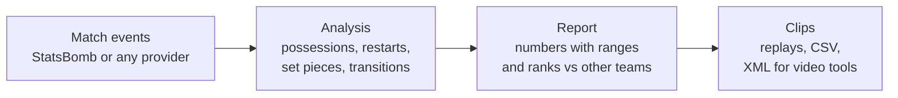

<div align="center">

# Automated Football Opposition Report

**Know how the next opponent plays, and how far each number can be trusted, from data anyone can download.**


<sub>Leverkusen vs Wolfsburg, 2023/24: a 19-pass build-up that ended in a goal, rebuilt from event data.</sub>

<br><br>


Master's thesis · Emanuele Colecchia · UNICAL / FH OÖ Hagenberg

</div>

---

## The thesis in short

Before every match, club analysts prepare an **opposition report**: a list of statements about the next opponent, such as "their goal kicks go short 40% of the time" or "PPDA 12.6". Analysts act on these statements, but nobody measures whether they actually hold in the next match. A number computed from five matches can look as solid as one computed from thirty.

This thesis builds an opposition report from event data (every pass, carry and shot with its position on the pitch) that states, **next to every number, how far it can be trusted**, with a grade from A to D. The grade is not an opinion. It comes from two measured properties of each type of statement:

- **Forecast skill:** does the value from past matches predict the value in the next match better than the league average?
- **Discrimination:** over a season, does the number really separate teams, or is most of the difference sampling noise? (after Franks et al., 2016)

**A** = strong forecast and high discrimination; **D** = neither. Every grade is shown in the report, D included.

### Research questions

| | Question | Answer |
|---|---|---|
| **RQ1** | Which statements of the report are reliable for the next match, and do the grades hold on a second data provider? | Graded on 70 unseen StatsBomb teams: **4 A, 13 B, 15 C, 2 D**. On Wyscout 2017/18 (96 teams): same letter in **21 of 29** statements (72%; the rule fixed beforehand was 70%), none two letters apart. **The grades hold, just.** |
| **RQ2** | Does a forecast that accounts for the next opponent and the venue (using only matches already played) beat the season average, and does it change which statements are reliable? | **Yes.** Better in 21 of 30 statements on StatsBomb (70 teams) and 18 of 25 on Wyscout (96 teams), worse in 2 and 1. Largest gains for pressing (PPDA) and shots; PPDA moves from C to A on both providers. |
| RQ3 (optional) | Do the grades help analysts decide what to rely on? | Not done yet: needs analysts. |

Every confirmatory test follows the same rule: the protocol (hypotheses, thresholds, decision rule) is committed **before** the single run, and result files are committed unedited. Negative results are reported. Protocols: `docs/protocol_*.md`; results: `results/`.

## The report tool

The grades live inside a working prototype: a local web app that builds the report for any team, shows each finding with the clips behind it, and puts the grade next to every headline number.



### What you get

<table>
<tr>
<td width="50%"></td>
<td width="50%"></td>
</tr>
<tr>
<td><b>Overview.</b> The team's typical build-up replayed pass by pass, and the five facts where it differs most from the other teams.</td>
<td><b>Clips.</b> Every possession with match and minute. Filter (for example "ended in a goal"), watch, and export for the video tool.</td>
</tr>
</table>

| Section | What it shows |
|---|---|
| **Build-up** | Possessions grouped into families (B1-B5 near the own goal, A1-A3 further up), with share, shot rate and stability |
| **Restarts** | Goal kicks, keeper distributions, throw-ins: short or long, which side, what happens next |
| **Set pieces** | Corners and free kicks: delivery zones, takers, receivers, shots and goals |
| **Transitions** | Where the ball is lost and won back, counter-press, shots in the next 10 seconds |
| **Defending** | Pressing (PPDA), pressures by zone, shots conceded |
| **Key players** | Who receives in the build-up, who creates danger, who takes set pieces |
| **Threat (xT)** | Which passes and carries move the ball into dangerous zones |

## Earlier results: the build-up families

Before the evidence grade, the thesis tested the report's main analysis (build-up possessions grouped into families) on 10 teams: Leverkusen 2023/24 and nine teams from the 2015/16 Premier League, La Liga, Serie A and Ligue 1. These results are why the thesis moved from "find the opponent's patterns" to "say how much each number can be trusted".

| Question | Answer |
|---|---|
| Do the build-up patterns hold up in matches the method has not seen? | **Yes**, in 8 of 10 teams |
| What makes them predictable? | Almost only how the possession starts (goal kick, throw-in, regain) |
| Are they clearly separate styles? | **Weakly.** They are better seen as slices of one continuum |
| Do they explain shots better than a simple rule? | **No**, in 0 of 10 teams |
| Can corner set-ups be exploited? | Not shown. The test could only have found very large effects |

All tables and details: [docs/results.md](docs/results.md).

## Try it

You need **Python 3.13** and **Node.js**. On Windows, in PowerShell:

```powershell
git clone https://github.com/emanuele-clc/football-opposition-report
cd football-opposition-report
pip install -r requirements.txt
powershell -ExecutionPolicy Bypass -File .\start_app.ps1
```

The app opens at **http://127.0.0.1:8765** with four example teams. Everything runs on your computer and nothing is uploaded.

<details>
<summary><b>Make a report for another team</b></summary>

<br>

```powershell
cd <data_folder>                                                              # downloads go into the current folder
python -X utf8 <repo>\src\week1\download_data.py 9 281 "Bayer Leverkusen"     # StatsBomb events -> matches\ and ev\
python -X utf8 <repo>\src\oppreport.py --statsbomb matches\9_281.json --data-dir . --team "Bayer Leverkusen" --out reports
python -X utf8 <repo>\src\oppreport.py --csv events.csv --team "Team name" --out reports   # data from any other provider
```

Then start the app on that folder: `.\start_app.ps1 -DataDir <data_folder>`. Always use `python -X utf8` on Windows (team names have accents). Format for other providers: [docs/data_format.md](docs/data_format.md). How to read the report: [docs/analyst_guide.md](docs/analyst_guide.md).

</details>

<details>
<summary><b>Check the results yourself</b></summary>

<br>

Each confirmatory test has a protocol in `docs/protocol_*.md`, committed before the run. Result files in `results/` are committed unedited.

```powershell
python -X utf8 tests\reproduce_results.py <data_dir> <new_work_dir>   # reruns the tests: 41/41 files identical
python -X utf8 tests\reproduce_sheets.py <data_dir>                    # reruns the report sheets: 50/50 identical
python -X utf8 tests\test_app_api.py                                   # app checks
```

Every analysis step: [docs/pipeline.md](docs/pipeline.md).

</details>

<details>
<summary><b>What is in this repository</b></summary>

<br>

```
src/         analysis (week1-4), report sheets (report/), provider adapters, tracking (exploratory), oppreport.py
app/         local web app (FastAPI + React), see app/README.md
tests/       reproducibility and app tests
docs/        protocols, detailed results, data format, analyst guide
results/     result files of every run (JSON)
examples/    example outputs for 4 teams (the app's default data)
data_info/   competition and match lists (raw events are not included)
```

</details>

## Limits

- It **describes** how a team plays. It does not say what will work against them.
- Families are numbered (B1, A2), not named: an analyst names them after watching the clips.
- The families were tested on ten teams, nine of them from one season (2015/16); the grades on public StatsBomb and Wyscout data only. Not yet tried on real club data or reviewed by an analyst. The XML export has not yet been tested in a real video tool.

---

<div align="center">
<sub>Data: <a href="https://github.com/statsbomb/open-data">StatsBomb Open Data</a> (StatsBomb, 2024), non-commercial licence · <a href="https://figshare.com/collections/Soccer_match_event_dataset/4415000">Wyscout public data</a> (Pappalardo et al., 2019), CC BY 4.0.</sub>
</div>
