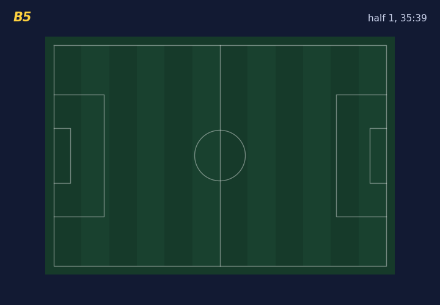
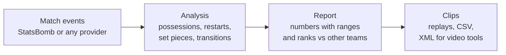
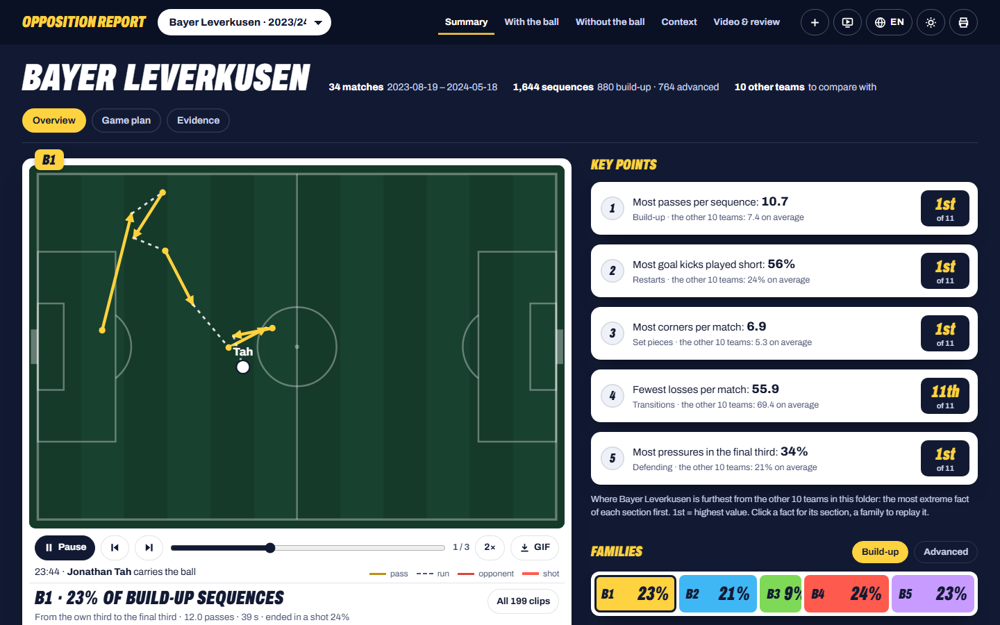
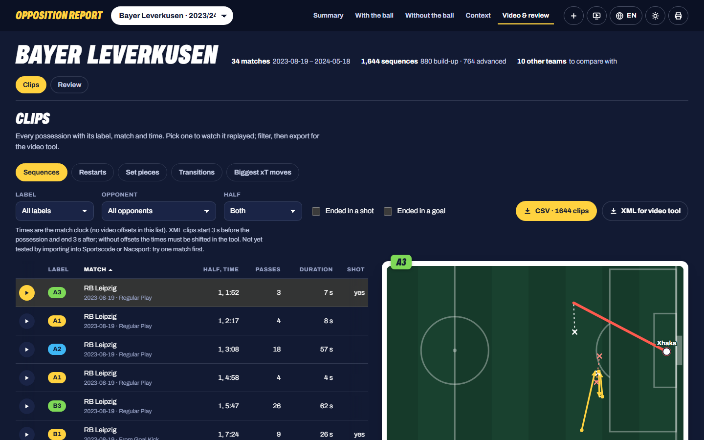

<div align="center">

# Automated Football Opposition Report

**Know how the next opponent plays, before the match, from data anyone can download.**



<sub>Leverkusen vs Wolfsburg, 2023/24: a 19-pass build-up that ended in a goal, rebuilt from event data.</sub>

<br><br>


Master's thesis · Emanuele Colecchia · UNICAL / FH OÖ Hagenberg

</div>

---

## The idea

Before every match, club analysts spend hours watching the next opponent: how they build from the back, how they take corners, where they lose the ball. This project does the first pass **automatically** from event data (every pass, carry and shot with its position on the pitch), and shows each finding with the clips behind it.

It also says **how much each number can be trusted**. Every figure comes with a range, a warning when there are too few matches, and a grade from A to D.

## How it works



## What you get

<table>
<tr>
<td width="50%"></td>
<td width="50%"></td>
</tr>
<tr>
<td><b>Overview.</b> The team's typical build-up replayed pass by pass, and the five facts where it differs most from the other teams.</td>
<td><b>Clips.</b> Every possession with match and minute. Filter (for example "ended in a goal"), watch, and export for the video tool.</td>
</tr>
</table>

| Section | What it shows |
|---|---|
| **Build-up** | Possessions grouped into families (B1-B5 near the own goal, A1-A3 further up), with share, shot rate and stability |
| **Restarts** | Goal kicks, keeper distributions, throw-ins: short or long, which side, what happens next |
| **Set pieces** | Corners and free kicks: delivery zones, takers, receivers, shots and goals |
| **Transitions** | Where the ball is lost and won back, counter-press, shots in the next 10 seconds |
| **Defending** | Pressing (PPDA), pressures by zone, shots conceded |
| **Key players** | Who receives in the build-up, who creates danger, who takes set pieces |
| **Threat (xT)** | Which passes and carries move the ball into dangerous zones |

## What the research found

The method was tested on 10 teams (Leverkusen 2023/24 and nine teams from the 2015/16 Premier League, La Liga, Serie A and Ligue 1). The main tests were written down and published **before** they were run, and negative results are reported too.

| Question | Answer |
|---|---|
| Do the build-up patterns hold up in matches the method has not seen? | **Yes**, in 8 of 10 teams |
| What makes them predictable? | Almost only how the possession starts (goal kick, throw-in, regain) |
| Are they clearly separate styles? | **Weakly.** They are better seen as slices of one continuum |
| Do they explain shots better than a simple rule? | **No**, in 0 of 10 teams |
| Can corner set-ups be exploited? | Not shown. The test could only have found very large effects |
| How far can each report statement be trusted? | Graded on 70 new teams: **4 A, 13 B, 15 C, 2 D** |
| Do the grades hold on a second data provider? (RQ1) | **Yes, just.** Wyscout 2017/18, 96 teams: same letter in 21 of 29 statements (72%, rule was 70%), none two letters apart |
| Does knowing the next opponent and the venue improve the forecast? (RQ2) | **Yes.** Better in 21 of 30 statements on StatsBomb (70 teams) and 18 of 25 on Wyscout (96 teams); largest for pressing (PPDA) and shots |

All tables and details: [docs/results.md](docs/results.md).

## Try it

You need **Python 3.13** and **Node.js**. On Windows, in PowerShell:

```powershell
git clone https://github.com/emanuele-clc/football-opposition-report
cd football-opposition-report
pip install -r requirements.txt
powershell -ExecutionPolicy Bypass -File .\start_app.ps1
```

The app opens at **http://127.0.0.1:8765** with four example teams. Everything runs on your computer and nothing is uploaded.

<details>
<summary><b>Make a report for another team</b></summary>

<br>

```powershell
cd <data_folder>                                                              # downloads go into the current folder
python -X utf8 <repo>\src\week1\download_data.py 9 281 "Bayer Leverkusen"     # StatsBomb events -> matches\ and ev\
python -X utf8 <repo>\src\oppreport.py --statsbomb matches\9_281.json --data-dir . --team "Bayer Leverkusen" --out reports
python -X utf8 <repo>\src\oppreport.py --csv events.csv --team "Team name" --out reports   # data from any other provider
```

Then start the app on that folder: `.\start_app.ps1 -DataDir <data_folder>`. Always use `python -X utf8` on Windows (team names have accents). Format for other providers: [docs/data_format.md](docs/data_format.md). How to read the report: [docs/analyst_guide.md](docs/analyst_guide.md).

</details>

<details>
<summary><b>Check the results yourself</b></summary>

<br>

Each confirmatory test has a protocol in `docs/protocol_*.md`, committed before the run. Result files in `results/` are committed unedited.

```powershell
python -X utf8 tests\reproduce_results.py <data_dir> <new_work_dir>   # reruns the tests: 41/41 files identical
python -X utf8 tests\reproduce_sheets.py <data_dir>                    # reruns the report sheets: 50/50 identical
python -X utf8 tests\test_app_api.py                                   # app checks
```

Every analysis step: [docs/pipeline.md](docs/pipeline.md).

</details>

<details>
<summary><b>What is in this repository</b></summary>

<br>

```
src/         analysis (week1-4), report sheets (report/), provider adapters, tracking (exploratory), oppreport.py
app/         local web app (FastAPI + React), see app/README.md
tests/       reproducibility and app tests
docs/        protocols, detailed results, data format, analyst guide
results/     result files of every run (JSON)
examples/    example outputs for 4 teams (the app's default data)
data_info/   competition and match lists (raw events are not included)
```

</details>

## Limits

- It **describes** how a team plays. It does not say what will work against them.
- Families are numbered (B1, A2), not named: an analyst names them after watching the clips.
- The families were tested on ten teams, nine of them from one season (2015/16); the grades on public StatsBomb and Wyscout data only. Not yet tried on real club data or reviewed by an analyst. The XML export has not yet been tested in a real video tool.

---

<div align="center">
<sub>Data: <a href="https://github.com/statsbomb/open-data">StatsBomb Open Data</a> (StatsBomb, 2024), non-commercial licence · <a href="https://figshare.com/collections/Soccer_match_event_dataset/4415000">Wyscout public data</a> (Pappalardo et al., 2019), CC BY 4.0.</sub>
</div>
